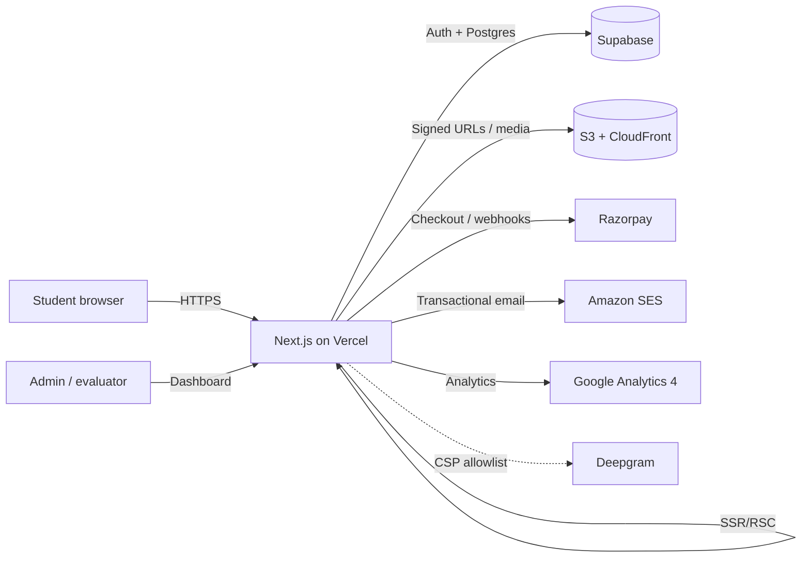
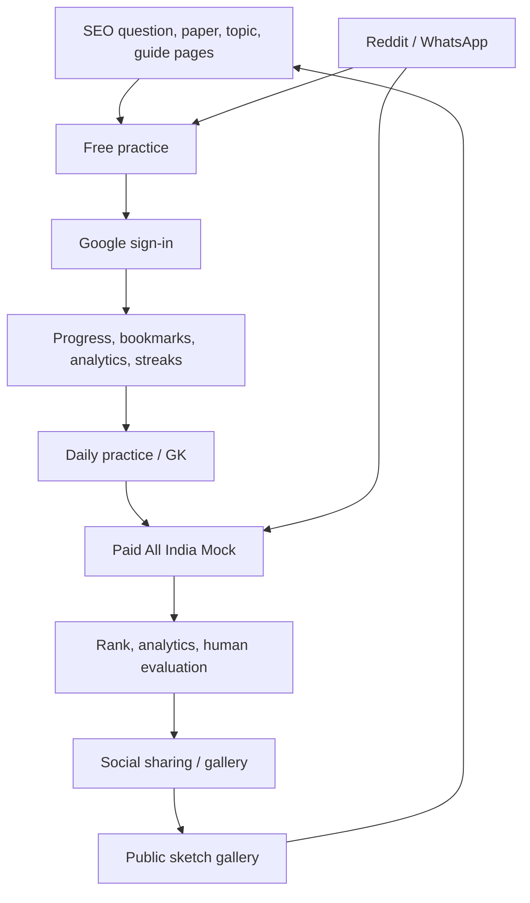

# Roughworks.in — Full Product, Content, and Technical Analysis

**Prepared:** 27 October 2026  
**Scope:** Public pages, public sitemap, public client-side bundles, and visible page behaviour. No authenticated dashboard, admin area, payment flow, or private user data was accessed.  
**Important:** This is an analysis, not a copy of the question bank. Roughworks' terms prohibit scraping, copying, or redistributing its code, content, or branding, and the terms state that the original question IP belongs to IIT Bombay, NID, and NIFT. The mock-test pack supplied with this report uses **original questions**, not copied Roughworks content.

---

## 1. Executive summary

Roughworks is a free, SEO-led preparation platform for Indian design entrance exams: **UCEED, CEED, NID UG, and NIFT**. It combines:

- a structured bank of **1,689 previous-year questions** from **27 papers** (2015–2026),
- topic-wise practice and full past-paper players,
- a paid **All India Mock** event with Part A + Part B, human-evaluated sketches, ranks, and analytics,
- a community sketch gallery and prompt library,
- daily GK practice, guides, cutoff tools, and a signed-in dashboard.

The product's real moat is not the website design. It is the combination of:

1. **Content structure** — every question is mapped to exam, year, paper, section, topic, difficulty, and question type.
2. **Exam realism** — the paper player reproduces section navigation, marking schemes, numerical keypads, multiple-select partial credit, rough-work canvas, and answer review.
3. **Programmatic SEO** — roughly 2,082 sitemap URLs, including about 1,694 paper/question pages, 58 topic hubs, 302 drawing-related pages, and 9 guide pages.
4. **Event operations** — paid mock registration, Razorpay checkout, roll numbers, DOB verification, signed access cookies, Part B uploads, human evaluation, and result publication.
5. **Community proof** — a public sketch gallery with claps and comments, plus Reddit and WhatsApp distribution.

The commercial model is simple: **free content acquires users; a low-ticket, high-urgency All India Mock converts them.** The 200-seat UCEED 2027 mock was sold out at the time of inspection, with a waitlist.

The biggest risk is **copyright and content licensing**. The site itself says the original question IP belongs to the exam bodies and prohibits scraping. A competitor cannot legally copy the bank. A viable alternative is to build the same *system* with original or licensed questions.

---

## 2. What the product is

### 2.1 Positioning

Roughworks positions itself as the anti-coaching, free, structured alternative for design entrance preparation:

> “Crack UCEED, CEED, NID, and NIFT without coaching.”  
> “No coaching, no gatekeeping. Just the work, and thousands of aspirants doing it with you.”

The brand metaphor is **rough work**: the unglamorous sketches, notes, and iterations behind a finished design. The homepage uses a “SPACE FOR ROUGH WORK”, golden-ratio, graph-paper, question-paper visual language.

### 2.2 Target audience

- Class 11–12 students preparing for UCEED/NID/NIFT.
- Graduates preparing for CEED.
- Self-study students who cannot afford coaching.
- Students who want past papers, timed practice, peer sketches, and performance feedback.

Public social proof observed:

- “Trusted by 7,700+ future designers.”
- “Trusted by 6,000+ future designers” on the mock page.
- 200 seats for the UCEED 2027 All India Mock, shown as fully booked.
- Individual question pages show attempt counts (e.g., hundreds of attempts on some questions).
- Gallery entries show claps and comments.

### 2.3 Core promise

- Past papers are free.
- No login is required to browse questions and papers.
- No ads or paywalls on the core content.
- Progress can be saved; signed-in users get dashboards and analytics.
- The paid mock is positioned as an exam-day rehearsal, not a content paywall.

---

## 3. Site map and product surfaces

| Surface | Route(s) | What it does |
|---|---|---|
| Home | `/` | Brand story, social proof, entry points to questions, papers, mocks, drawings. |
| Question bank | `/questions` | 1,689 PYQs; filters by exam, topic, year, difficulty, type; browse or build a practice set. |
| Paper library | `/papers`, `/papers/uceed`, `/papers/ceed`, `/papers/nid-ug`, `/papers/nift` | Lists papers by exam and year, with question counts and paper actions. |
| Paper player | `/papers/{exam}/{year}/{questionId}` | Full-paper question interface: palette, answer input, marking scheme, score, rough work, bookmark, report. |
| Syllabus/topic matrix | `/syllabus/uceed`, `/syllabus/ceed` | Topic × year heatmap with counts and direct practice links. |
| Exam/topic hubs | `/exams`, `/exams/{exam}`, `/exams/{exam}/{topic}` | 58 topic pages; count, difficulty, and practice entry points. |
| All India Mock | `/mocks`, `/mocks/register` | Event landing page, schedule, seats, passes, waitlist, registration. |
| Mock window | `/mock-window` | Exam-day entry/waiting area; access-controlled. |
| Drawings | `/drawings` | 121 drawing prompts from papers plus original practice briefs; category and duration filters. |
| Sketch gallery | `/drawings/gallery`, `/drawings/gallery/{uuid}` | Public community gallery; claps, comments, upload via dashboard. |
| Daily GK | `/gk` | Five-question daily quiz, flashcards, wrong box, streaks/sparks. |
| Guides | `/guides`, `/guides/{slug}` | SEO content: topic weightage, syllabus, exam pattern, registration, cutoffs, score guidance. |
| Cutoff tools | `/tools/cutoffs/...` | IIT/UCEED cutoff pages for multiple institutes. |
| Auth | `/login` | Google OAuth via Supabase Auth. |
| Dashboard | `/dashboard/*` | Papers, practice, bookmarks, mocks, sketches, GK, settings, analytics. |
| Admin | `/dashboard/admin/*` | Admin and impersonation routes (protected). |
| Legal | `/privacy`, `/terms` | Privacy policy, terms, refunds, mock rules, IP statement. |
| News | `/news`, `/news/{slug}` | Announcements and statements. |
| 404 | any unknown route | Playful “Q404” MCQ page with a rough-work canvas. |

The site is broad but coherent: every surface feeds either **practice**, **community**, **exam simulation**, or **SEO acquisition**.

---

## 4. Content inventory

### 4.1 Overall content scale

| Exam | Papers | Questions | Years covered |
|---|---:|---:|---|
| UCEED | 12 | 878 | 2015–2026 |
| CEED | 9 | 382 | 2018–2026 |
| NID UG | 2 | 29 | 2020, 2024 |
| NIFT | 4 | 400 | 2022, 2024, 2025, 2026 |
| **Total** | **27** | **1,689** | **2015–2026** |

Additional content observed:

- **121 drawing prompts** in the prompt library.
- **302 drawing-related sitemap URLs** (prompt and gallery pages).
- **58 exam/topic hub pages**.
- **8 prep guides**, plus the guide index.
- **8 cutoff tool pages**.
- **3 news pages**.
- **2 syllabus matrices** (UCEED and CEED).
- A public gallery with 24+ sketches visible before “Show more sketches”.

### 4.2 Papers by year and question count

**UCEED**

| Year | 2015 | 2016 | 2017 | 2018 | 2019 | 2020 | 2021 | 2022 | 2023 | 2024 | 2025 | 2026 |
|---|---:|---:|---:|---:|---:|---:|---:|---:|---:|---:|---:|---:|
| Questions | 100 | 80 | 85 | 85 | 85 | 68 | 68 | 68 | 68 | 57 | 57 | 57 |

**CEED**

| Year | 2018 | 2019 | 2020 | 2021 | 2022 | 2023 | 2024 | 2025 | 2026 |
|---|---:|---:|---:|---:|---:|---:|---:|---:|---:|
| Questions | 41 | 45 | 41 | 41 | 41 | 41 | 44 | 44 | 44 |

**NID UG**

| Year | 2020 | 2024 |
|---|---:|---:|
| Questions | 21 | 8 |

**NIFT**

| Year | 2022 | 2023 | 2024 | 2025 | 2026 |
|---|---:|---:|---:|---:|---:|
| Questions | 100 | not listed | 100 | 100 | 100 |

The NIFT library says “4 papers · 2022–2026”; 2023 is not present in the public paper list.

### 4.3 Topic taxonomy and weightage

The topic taxonomy is one of the most valuable parts of the product. It lets the site create a page for every exam-topic combination, show counts, and link directly into a filtered practice session.

**UCEED — 878 questions, 15 topics**

| Topic | Questions | Share |
|---|---:|---:|
| Spatial Reasoning | 206 | 23.5% |
| Visual Reasoning | 127 | 14.5% |
| Analytical Reasoning | 113 | 12.9% |
| Pattern Recognition | 81 | 9.2% |
| Design Awareness | 69 | 7.9% |
| Numerical Reasoning | 58 | 6.6% |
| General Knowledge | 50 | 5.7% |
| Observation | 46 | 5.2% |
| Language | 32 | 3.6% |
| Indian Culture | 29 | 3.3% |
| Typography | 26 | 3.0% |
| Design History | 13 | 1.5% |
| Colour Theory | 12 | 1.4% |
| English | 8 | 0.9% |
| Materials | 8 | 0.9% |

**CEED — 382 questions, 14 topics**

| Topic | Questions | Share |
|---|---:|---:|
| Spatial Reasoning | 105 | 27.5% |
| Design Awareness | 68 | 17.8% |
| Visual Reasoning | 47 | 12.3% |
| Analytical Reasoning | 42 | 11.0% |
| Pattern Recognition | 29 | 7.6% |
| Numerical Reasoning | 25 | 6.5% |
| Observation | 14 | 3.7% |
| Typography | 12 | 3.1% |
| General Knowledge | 9 | 2.4% |
| Indian Culture | 9 | 2.4% |
| Design History | 8 | 2.1% |
| Language | 7 | 1.8% |
| Materials | 5 | 1.3% |
| Colour Theory | 2 | 0.5% |

**NIFT — 400 questions, 16 topics**

| Topic | Questions | Share |
|---|---:|---:|
| English | 132 | 33.0% |
| Quantitative Aptitude | 60 | 15.0% |
| General Knowledge | 55 | 13.8% |
| Language | 39 | 9.8% |
| Analytical Reasoning | 25 | 6.3% |
| Pattern Recognition | 19 | 4.8% |
| Indian Culture | 16 | 4.0% |
| Numerical Reasoning | 16 | 4.0% |
| Fashion & Textile | 11 | 2.8% |
| Maths | 8 | 2.0% |
| Spatial Reasoning | 6 | 1.5% |
| Design Awareness | 5 | 1.3% |
| Visual Reasoning | 4 | 1.0% |
| Materials | 2 | 0.5% |
| Colour Theory | 1 | 0.3% |
| Design History | 1 | 0.3% |

**NID UG — 29 questions, 8 topics**

| Topic | Questions |
|---|---:|
| General Knowledge | 9 |
| Analytical Reasoning | 5 |
| Design Awareness | 4 |
| Spatial Reasoning | 4 |
| Pattern Recognition | 3 |
| Indian Culture | 2 |
| Colour Theory | 1 |
| Numerical Reasoning | 1 |

NID UG is clearly the thinnest area: only two papers and 29 questions. That is both a content gap and an opportunity for a new entrant.

### 4.4 UCEED topic trends (2015–2026)

The syllabus matrix exposes a year-by-year topic distribution. Some patterns:

- **Spatial Reasoning is the largest topic** overall, but it fell from 28 questions in 2019 and 2020 to 8 in 2026. It is still 23.5% of the bank.
- **Visual Reasoning** peaked at 16 in 2017 and has been around 8–11 in recent years.
- **Analytical Reasoning** is volatile: 5–15 questions per year.
- **Design Awareness** went to 0 in 2024, then returned with 3 in 2025 and 7 in 2026.
- **General Knowledge** had 15 questions in 2016, 0 in 2020 and 2021, and 5 in 2026.
- **Indian Culture** was absent from 2020–2024, then returned with 5 in 2025 and 4 in 2026.
- **English** appears only in 2015 (8 questions) in the UCEED bank.
- **Materials** had 3 questions in 2025 and 0 in 2026.

This is exactly the kind of analysis that makes the product feel data-driven rather than like a generic question dump. It also creates valuable SEO pages: “topic weightage”, “syllabus”, “exam pattern”, “cutoff”.

### 4.5 Paper formats and marking schemes

Observed from the paper player:

**UCEED 2026**

- 57 questions, 200 marks.
- Section 1: NAT, 14 questions, +4 correct, 0 wrong.
- Section 2: MSQ, 15 questions, +4 correct, −1 wrong, partial credit: +1 per correct option if no wrong option is picked.
- Section 3: MCQ, 28 questions, +3 correct, −0.71 wrong.
- Unattempted questions score 0.

**CEED 2026**

- 44 questions, 150 marks.
- Section 1: NAT, 8 questions, +4 correct, 0 wrong.
- Section 2: MSQ, 10 questions, +4 correct, −1 wrong, same partial-credit rule.
- Section 3: MCQ, 26 questions, +3 correct, −0.5 wrong.

**NIFT 2026**

- 100 questions, 100 marks.
- Four MCQ sections: Communication Ability and English Comprehension; Quantitative Ability; Analytical and Logical Ability; General Knowledge and Current Affairs.
- +1 correct, −0.25 wrong, 0 unattempted.

**NID UG 2024**

- 8 questions, 10 marks.
- Part A, 1 mark each (MCQ): +1 correct, 0 wrong.
- Part A, 2 marks each (MCQ): +2 correct, 0 wrong.

Older papers may use different section counts and marking rules; the paper player appears to store a marking scheme per paper or per section rather than assuming one global rule.

---

## 5. How the system works

### 5.1 Guest browsing

A visitor can:

1. Land on the homepage or an SEO question page.
2. Browse `/questions` and filter by exam/topic/year/difficulty/type.
3. Open a question or a full paper without signing in.
4. Answer, reveal the answer, use the rough-work canvas, bookmark, or report a discrepancy.
5. See a score/progress indicator.

The site explicitly advertises “No login required” for papers. The privacy policy says anonymous analytics are collected via Google Analytics, and that accounts are optional. Guest progress is therefore likely stored locally (localStorage or similar) and merged/synced after sign-in; signed-in progress is stored in Supabase. The exact merge logic was not inspected.

### 5.2 Account and dashboard

Sign-in is **Google OAuth** through **Supabase Auth**. After sign-in, onboarding collects profile data such as display name, username, optional phone, and target exam preferences.

The dashboard routes observed in the client bundle include:

- `/dashboard/papers`
- `/dashboard/practice`
- `/dashboard/mocks`
- `/dashboard/bookmarks`
- `/dashboard/sketches`
- `/dashboard/sketch-review`
- `/dashboard/gk`
- `/dashboard/settings`
- `/dashboard/analytics`
- `/dashboard/admin`
- `/dashboard/admin/impersonate`

The public dashboard is likely the retention layer: saved attempts, bookmarks, practice sets, mock analytics, sketch uploads, GK streaks, and account settings.

### 5.3 Question-bank practice flow

The `/questions` page shows **1,689 PYQs**, with **50 per page**. It has two modes:

- **Browse** — scan the bank.
- **Practice** — build a focused set.

Observed controls include filters for exam/topic/year/difficulty, a “Skip previously done” option, and practice-set sizes of 10, 25, 50, or custom. The URL pattern for a filtered practice set is:

```
/questions?exam=UCEED&year=UCEED%3A2015&topic=Spatial+Reasoning&mode=practice
```

This is important: the practice engine is driven by URL parameters, which makes every topic/year combination shareable and indexable. The site can generate a practice link for every cell in the syllabus matrix.

A practice session is recorded in `practice_sessions`, with the selected items in `practice_sets` (table names observed in the client bundle). Questions attempted are recorded in `question_attempts`.

### 5.4 Full paper flow

The paper player is the most sophisticated public surface.

Observed layout:

- Paper title and exam/year.
- Section palette: Section 1/NAT, Section 2/MSQ, Section 3/MCQ, with per-section answered counts and question numbers.
- Current question with:
  - question number and section/type,
  - difficulty label,
  - question text and image(s),
  - NAT numeric keypad or MSQ/MCQ options,
  - “Show answer”,
  - marking-scheme panel,
  - bookmark,
  - report/discrepancy action,
  - rough-work canvas,
  - full-screen image view.
- Footer navigation: previous/next, “All {exam} papers”.
- Score/progress indicator; “Take the timed mock” entry point (requires login and leads to dashboard papers).

The paper player is a **practice player**, not the scheduled mock. It lets a student work through a paper at their own pace, reveal answers, and see scoring. The scheduled mock is a separate event with a fixed window.

### 5.5 Timed mock flow

The `/mocks` page is a full event landing page. Observed for the UCEED 2027 All India Mock:

- 200 seats.
- Part A + Part B.
- 300 marks.
- 3 hours total: Part A 10 AM–12 PM, Part B 12 PM–1 PM, upload window closes 1:30 PM IST.
- “Exact interface”, “Exam-day flow”, “Paper design”, “Human evaluation”, “Ranks & analytics”.
- Solo pass ₹99; Friend pass ₹149 for two seats.
- All 200 seats booked; waitlist available.
- Schedule table: registrations open, last date, waiting area, Part A, Part B, upload close, results.
- Registration requires Google sign-in.
- Checkout via Razorpay.
- Companion code for the Friend pass; the second candidate signs in separately and claims the code.

The privacy policy adds important details about the exam-day access control:

- A confirmed registration gets a roll number.
- The candidate signs in to the registered account.
- The candidate enters their date of birth in DDMMYYYY format.
- The DOB check happens server-side against the private registration record.
- On success, the server sets a signed, HttpOnly, event-specific access cookie that expires when the upload window closes.
- Admit cards are sent by Amazon SES and include a QR code/barcode and payment details for the payer.
- Registration collects full name, contact details, DOB, Class XII passing year, home state, self-reported UCEED reservation category, and PwD status.

This is a serious event-operations design, not just a quiz page. It handles seat inventory, identity, payment, access control, and evaluation.

### 5.6 Part B and human evaluation

Part B is the drawing/sketch component. The site has:

- A **prompt library** of 121 prompts, including past UCEED/CEED/NID/NIFT prompts and original practice briefs.
- A **public gallery** where students upload sketches, receive claps and comments, and browse others' work.
- A **sketch-review** dashboard route, likely for feedback/evaluation.
- A **human-evaluated** Part B in the paid mock.

The paid mock's value proposition depends on human evaluation and moderation. The terms say Part B evaluation involves human judgment and may include moderation. The results page includes ranks and analytics for the mock cohort, not official exam ranks.

### 5.7 Daily GK and gamification

`/gk` is a five-question daily quiz with:

- Quick Quiz and Flashcards modes.
- A “Wrong Box” for questions answered incorrectly.
- Categories and streaks.
- A limit on free questions; more after signing in.

The client bundle references “sparks” APIs:

- `/api/sparks/attempt`
- `/api/sparks/daily-login`
- `/api/sparks/mock-complete`

This suggests a points/streak system rewarding daily logins, attempts, and mock completion. The public UI does not make the full economy obvious, but the hooks are there.

### 5.8 Community and UGC

The gallery is a real UGC loop:

- Student uploads a sketch for a prompt.
- The sketch appears publicly with title, author, prompt, claps, and comments.
- Other students browse, react, and discuss.
- The upload entry point is `/dashboard/sketches?upload=1`.
- The terms grant Roughworks a non-exclusive, royalty-free licence to display public submissions; removal requests go to email.

The gallery is valuable for:

- social proof,
- retention,
- inspiration,
- long-tail SEO,
- content for social media,
- demonstrating the outcome of the paid mock.

### 5.9 Guides, tools, and SEO content

The content marketing stack includes:

- **8 guides**: CEED and UCEED topic weightage analyses, previous-year-paper strategy, UCEED syllabus, DTU BDes cutoff, exam pattern and marking scheme, registration guide, and “what is a good score”.
- **8 cutoff pages** for IIT Bombay, IIT Delhi, IIT Guwahati, IIT Hyderabad, IIT Indore, IIT Roorkee, and IIITDM Jabalpur.
- **58 exam/topic hubs**.
- **Syllabus matrices** for UCEED and CEED.
- **Question pages** with schema markup.
- **Gallery pages** with user-generated content.

This is a classic programmatic SEO + editorial content strategy.

---

## 6. Technical architecture

### 6.1 Observed stack

| Layer | Observed signal | Interpretation |
|---|---|---|
| Framework | `x-powered-by: Next.js`; App Router/RSC payloads; immutable chunk URLs | Next.js App Router with React Server Components. |
| Hosting | `server: Vercel`; `x-vercel-id` | Vercel deployment. |
| Auth | Google OAuth; privacy policy names Supabase Auth | Supabase Auth with Google provider. |
| Database | Supabase client in bundles; privacy policy names Supabase database | Postgres via Supabase. |
| File storage | CSP allows `*.supabase.co`, `roughworks-sketches-prod.s3.ap-south-1.amazonaws.com`, CloudFront | Sketch images likely in S3 + CloudFront; some assets in Supabase Storage. |
| Payments | Razorpay checkout script; privacy policy names Razorpay | Razorpay orders, checkout, webhooks, reconciliation. |
| Email | Privacy policy names Amazon Simple Email Service | Transactional email and admit-card PDFs via SES. |
| Analytics | Google Analytics/GA4; `googletagmanager.com` | Page analytics and conversion tracking. |
| Voice/AI allowlist | CSP allows `api.deepgram.com`, `agent.deepgram.com`, websockets | A speech/voice integration is allowlisted; no public UI using it was observed. It may be planned or used in an authenticated feature. |
| CSS/UI | Tailwind-like utility classes in markup | Utility-first styling, custom design system. |
| SEO | Sitemap, robots, canonical, OG/Twitter, JSON-LD `Question` + `BreadcrumbList` | Strong technical SEO. |
| Dark mode | `rw-appearance-mode` localStorage; `.dark` class | User-selectable appearance with dark default. |
| Security | CSP, `frame-ancestors 'none'`, signed HttpOnly mock cookie | Reasonable baseline; CSP uses `unsafe-inline` for scripts/styles. |

### 6.2 High-level architecture



### 6.3 Data model observed in the client bundle

The client bundle references these Supabase tables:

| Table | Likely purpose |
|---|---|
| `profiles` | User profile, display name, username, target exams, phone. |
| `question_attempts` | Per-question attempt history, selected answer, correctness. |
| `paper_sessions` | A user's progress through a full paper. |
| `practice_sessions` | A user's practice-set session. |
| `practice_sets` | The generated set of questions for a practice session. |
| `bookmarks` | Saved questions. |
| `daily_activity` | Daily streaks/sparks/activity. |
| `gk_attempts` | Daily GK answers and results. |
| `mock_sessions` | Timed mock session/access state. |
| `mock_attempts` | Mock attempt summary and scores. |

The server schema almost certainly includes content tables not exposed to the client: exams, papers, sections, topics, questions, options, solutions, media/assets, mock events, registrations, payments, evaluations, and gallery posts. Those are inferred from the product surfaces, not directly observed.

### 6.4 Content delivery and SEO

The site is server-rendered, not a pure client-side SPA. Question pages return:

- a page title built from the question,
- a meta description that includes the answer/type/topic,
- a canonical URL,
- `og:type=article`,
- `Question` and `BreadcrumbList` JSON-LD,
- an H1 containing the question text.

The sitemap contains approximately:

| URL group | Count |
|---|---:|
| `/papers/...` | 1,694 |
| `/drawings/...` | 302 |
| `/exams/...` | 58 |
| `/guides/...` | 9 |
| `/tools/...` | 8 |
| `/news/...` | 3 |
| `/syllabus/...` | 2 |
| Core pages | ~6 |
| **Total** | **~2,082** |

`robots.txt` allows crawling, disallows filtered `/questions?*` URLs, `/api/*`, and `/dashboard/*`, and points to the sitemap.

This is a deliberate **programmatic SEO** strategy: every question, paper, topic, guide, cutoff, and public sketch is a potential landing page. The free question pages capture search traffic; the account and mock capture conversion.

### 6.5 Session and access control

- Normal auth: Supabase Auth session, likely cookie-based SSR sessions.
- Mock access: signed, HttpOnly, event-specific cookie set only after account login + DOB verification.
- Payment: Razorpay order + webhook + reconciliation records.
- Admin: `/dashboard/admin` and impersonation endpoints; presumably role-gated. The existence of impersonation is a support/debug capability and should be tightly audited.
- Client state: localStorage for appearance and likely guest progress; server state for signed-in users.

### 6.6 Performance and caching signals

- Pages return `Cache-Control: private, no-cache, no-store, max-age=0, must-revalidate`; the app is dynamically rendered per request.
- Static assets use immutable, content-hashed chunk URLs.
- Fonts are self-hosted with immutable caching.
- RSC payloads and SSR HTML make the pages SEO-friendly but can make them heavy; question pages include full question content and metadata.
- Images are served from S3/CloudFront, with some Supabase-hosted assets.
- The CSP is fairly strict on framing and object embedding, but allows inline scripts/styles and multiple third parties.

---

## 7. Growth engine

### 7.1 Growth loops



### 7.2 Acquisition

- **Programmatic SEO** on question, paper, topic, syllabus, cutoff, and guide pages.
- **Question schema** and answer-rich meta descriptions to win search snippets.
- **Free access** removes the signup wall and encourages sharing.
- **Reddit** (`r/DesignEntranceIndia`) and **WhatsApp** community distribution.
- **Social proof**: 7,700+ users, 6,000+ mock participants, sold-out seats, gallery claps.
- **Founder/brand voice**: the site is openly built by “Bhargab” and uses a distinctive anti-coaching narrative.

### 7.3 Activation

- A visitor can answer a question immediately, with no account.
- “Show answer” gives instant feedback.
- The rough-work canvas and paper interface make the product feel like an exam, not a blog.
- Sign-in is positioned as a way to save progress, not as a gate.

### 7.4 Retention

- Saved progress and bookmarks.
- Practice sets.
- Daily GK streaks and “sparks”.
- Dashboard analytics.
- Sketch gallery and feedback.
- Mock event countdown and results.
- Guides and cutoff pages for planning.

### 7.5 Monetization

- Free content builds trust and traffic.
- Paid mock converts at the moment of highest intent: before the exam, with a fixed date, limited seats, and peer comparison.
- The Friend pass lowers the effective per-seat price and encourages referrals.
- Waitlist captures demand when seats sell out.
- Future expansion could include more mock dates, evaluations, mentorship, or cohort programs, but those are not publicly visible.

---

## 8. Brand, UX, and content design

### 8.1 Visual identity

- Dark, paper-like background with off-white text and a lime/acid accent.
- Graph-paper, measurement, golden-ratio, and exam-question motifs.
- “SPACE FOR ROUGH WORK” as a recurring brand line.
- Question numbers styled like exam paper items (`Q.47`).
- Minimal, editorial, almost brutalist layout rather than a generic edtech dashboard.
- The 404 page is itself an MCQ, with a rough-work canvas.

### 8.2 Voice

Examples of the brand voice:

- “Nobody frames their rough work. Yet every great design starts there.”
- “No coaching, no gatekeeping. Just the work, and thousands of aspirants doing it with you.”
- “Perfection starts with roughworks.”
- “This page isn't in the paper.” (404)

The voice is confident, anti-elite, process-oriented, and slightly irreverent. It differentiates the product from coaching-centre marketing.

### 8.3 UX details worth copying (in spirit, not literally)

- Skip-to-content link.
- Aria labels on icon-only buttons.
- Dark/light toggle.
- Sticky navigation and mobile menu.
- Cookie/local-storage notice.
- Question palette with answered counts.
- Numeric keypad for NAT.
- Partial-credit explanation inside the marking-scheme panel.
- “Show answer” instead of forcing submission.
- Rough-work canvas.
- Bookmark and report actions.
- Full-screen image viewing.
- “All papers” escape hatch.
- Practice filters that map to shareable URLs.
- Mobile-friendly gallery and upload flow.

### 8.4 Accessibility observations

Positive signals: skip link, semantic regions, aria labels, keyboard-friendly buttons, text alternatives in some places. Unknowns: full keyboard navigation for the drawing canvas, screen-reader behavior for complex SVG/image questions, reduced-motion support, contrast in all themes, and form error handling. A new product should target WCAG 2.2 AA from the start.

---

## 9. Business model and unit economics

### 9.1 Pricing observed

| Product | Price | Scope |
|---|---:|---|
| Solo pass | ₹99 | One seat for the UCEED 2027 All India Mock. |
| Friend pass | ₹149 | Two seats; one payment; companion code. |
| Core question bank | Free | No login required. |
| Past papers | Free | No login required. |
| Drawings/prompts | Free | Public. |
| Daily GK | Free, with limits | More after sign-in. |

### 9.2 Illustrative revenue at full occupancy

- 200 solo seats × ₹99 = **₹19,800**.
- 100 friend passes × ₹149 = **₹14,900** for 200 seats.
- A mixed pass mix falls between those figures.

This is gross seat revenue before payment fees, human evaluation, support, infrastructure, and refunds. The event is likely as much a **trust and lead-generation product** as a profit centre. It creates proof, urgency, and content for future cohorts.

### 9.3 Why the model works

- The free bank creates a large top of funnel.
- The paid mock is a high-intent, time-bound purchase.
- Human evaluation and ranks justify a paid experience that a free question bank cannot replicate.
- The 200-seat cap creates scarcity and makes operations manageable.
- The waitlist captures demand and builds an email/community list.
- The Friend pass turns buyers into distributors.

### 9.4 Cost drivers

- Content acquisition, mapping, answer verification, and explanation writing.
- Media storage and bandwidth.
- Human sketch evaluators and moderation.
- Payment gateway fees and reconciliation.
- Customer support and event operations.
- Engineering and hosting.
- Legal/compliance and data protection.

---

## 10. Strengths

1. **Deep, structured content.** 1,689 questions across 27 papers, mapped to topics and years.
2. **Exam realism.** Section palettes, marking schemes, NAT keypad, MSQ partial credit, rough work, and review.
3. **Strong SEO.** ~2,082 indexable URLs, question schema, topic hubs, guides, cutoffs, and UGC.
4. **Free core.** Low friction, high trust, and shareability.
5. **Distinctive brand.** The rough-work metaphor is memorable and coherent.
6. **Community.** Public sketch gallery, claps, comments, and peer learning.
7. **Data-driven positioning.** Topic weightage and year-by-year analysis make the content feel authoritative.
8. **Event operations.** Paid mock with identity checks, signed access, uploads, human evaluation, and results.
9. **Retention loops.** Dashboard, bookmarks, practice sets, daily GK, streaks/sparks.
10. **Distribution.** Reddit, WhatsApp, SEO, and social proof.

---

## 11. Weaknesses, risks, and gaps

### 11.1 Copyright and licensing (highest risk)

The terms state:

- Questions are sourced from official past papers.
- All intellectual property in the original question content belongs to IIT Bombay, NID, and NIFT.
- Users may not scrape, copy, or redistribute any part of the site, including code, content, and branding, without permission.

Public availability of a past paper does **not** mean it is public domain. A new product should not copy the Roughworks bank, and should not assume it can freely republish official papers at scale. It needs:

- a written licence from the content owner,
- a licence/permission from the exam body, or
- original questions written in the same style.

### 11.2 Accuracy and trust

The terms include a “no guarantee of accuracy” disclaimer. A single wrong answer or explanation can damage trust in an exam-prep product. The site needs a review workflow, error reports, versioning, and a public correction log.

### 11.3 Content gaps

- NID UG is thin: 2 papers, 29 questions.
- NIFT 2023 is not listed.
- Some topics have very small samples (e.g., NIFT Colour Theory = 1, Design History = 1).
- Part B evaluation is concentrated in the paid mock; free users get prompts and gallery feedback, not structured evaluation.
- The question bank is broad but not obviously adaptive; practice is filter-based rather than personalized.

### 11.4 Product gaps

- No visible adaptive difficulty or spaced repetition.
- No visible AI tutor/explanation chat in public flows.
- No visible mobile app or offline mode.
- Limited evidence of sectional timers, full-length timed practice outside the paid event, or personalized study plans.
- No visible teacher/coaching dashboard or cohort analytics.
- No visible multilingual support.
- No visible accessibility statement.

### 11.5 Operational risks

- Human evaluation does not scale linearly; results delays and evaluator variance are risks.
- Payment/registration reconciliation and refunds are operationally heavy.
- Mock-day technical failure is high-impact and reputationally expensive.
- Community moderation and removal requests require process.
- Customer support is concentrated in a single email/WhatsApp/Reddit presence.

### 11.6 Security and privacy

- Collects DOB, phone, category, PwD status, payment metadata, and exam activity.
- Category/PwD data is sensitive and must be tightly access-controlled.
- Admin impersonation endpoints are a high-risk capability; they need strong role checks, audit logs, and alerts.
- CSP allows `unsafe-inline` scripts/styles; this weakens XSS defense.
- Google OAuth and Razorpay create third-party dependencies.
- DPDP Act 2023 (India) compliance, retention, deletion, and minor consent need explicit handling.

### 11.7 Market risks

- SEO dependency; AI search and answer engines may reduce clicks.
- Competition from coaching institutes, YouTube, Telegram, and other question banks.
- Free content is easy to imitate; the defensible parts are structure, community, event ops, and brand.
- Exam bodies can change patterns, marking, or paper availability.
- Official rank/percentile claims must be carefully disclaimed; the site does this.

---

## 12. If you want to build a similar product without copying

### 12.1 Product principle

Build the **system**, not the **content copy**:

- original or licensed questions,
- the same exam-like player,
- topic taxonomy and analytics,
- timed mocks with human/AI-assisted evaluation,
- community and SEO,
- clean legal and privacy foundations.

### 12.2 Recommended MVP (6–8 weeks)

**Week 1 — Content and schema**

- Pick one exam first (UCEED is the best beachhead: largest audience and richest taxonomy).
- Define 12–15 topics.
- Write 150–250 original questions across NAT/MSQ/MCQ.
- Write 3 full mock papers and 10 drawing prompts.
- Create a question schema with source/licence fields.

**Week 2 — Exam engine**

- Question player with palette, timer, autosave, mark-for-review, answer review.
- NAT/MSQ/MCQ scoring with configurable marking rules.
- Section and paper results.

**Week 3 — Accounts and dashboard**

- Google sign-in.
- Progress, bookmarks, practice sets.
- Basic analytics: accuracy by topic, time per question, attempt history.

**Week 4 — Timed mock**

- Mock event page, registration, seat inventory, waitlist.
- Payment (Razorpay or Stripe) or manual registration for the first cohort.
- Roll number, access window, submit lock.

**Week 5 — Part B**

- Prompt library and upload.
- Rubric-based evaluation; one or two evaluators; moderation.
- Results and feedback.

**Week 6 — SEO and launch**

- Sitemap, canonical, question schema, topic hubs.
- 5–10 guides.
- QA, accessibility, privacy policy, terms, refund policy.
- Launch to a small cohort; collect feedback.

### 12.3 Recommended stack

| Layer | Recommendation |
|---|---|
| Frontend | Next.js (App Router) + TypeScript + Tailwind CSS. |
| UI | Custom design system or shadcn/ui; avoid looking like a generic dashboard. |
| Auth | Supabase Auth or Auth.js with Google. |
| Database | Postgres (Supabase, Neon, or RDS) + Drizzle/Prisma. |
| Storage | S3/R2 + CloudFront; signed upload URLs. |
| Payments | Razorpay for India; Stripe for international. |
| Email | Resend or Amazon SES. |
| Analytics | PostHog + GA4; privacy-friendly event tracking. |
| Hosting | Vercel or Fly.io/Render. |
| Monitoring | Sentry + uptime checks + audit logs. |
| Content | Versioned JSON/MDX + admin editor; media in object storage. |

### 12.4 Proposed data model

```text
users
profiles
exams
papers
paper_sections
topics
questions
question_options
question_solutions
assets
practice_sets
practice_set_items
attempts
attempt_answers
paper_sessions
bookmarks
mock_events
mock_passes
mock_registrations
mock_companion_codes
mock_attempts
mock_submissions
evaluations
payments
daily_gk_sets
gk_attempts
sketch_posts
sketch_comments
sketch_claps
sparks_ledger
audit_logs
```

### 12.5 Question schema

```json
{
  "id": "q_uceed_orig_0001",
  "exam": "UCEED",
  "paper": "original-mock-1",
  "section": "NAT",
  "topic": "Spatial Reasoning",
  "difficulty": "medium",
  "type": "NAT",
  "prompt": "Question text...",
  "figure": null,
  "options": [],
  "correctAnswer": 24,
  "tolerance": 0.01,
  "marks": 4,
  "negative": 0,
  "partialCredit": false,
  "solution": "Explanation...",
  "source": "original",
  "licence": "owned",
  "status": "published",
  "version": 1
}
```

For MSQ:

```json
{
  "type": "MSQ",
  "options": ["A", "B", "C", "D"],
  "correctAnswer": ["A", "B", "C"],
  "marks": 4,
  "negative": 1,
  "partialCredit": true,
  "partialRule": "one mark per correct option if no wrong option is selected"
}
```

### 12.6 Scoring engine

```ts
function scoreQuestion(q, response) {
  if (response == null || response === "" || response.length === 0) return 0;

  if (q.type === "NAT") {
    return Math.abs(Number(response) - Number(q.correctAnswer)) <= (q.tolerance ?? 0.01)
      ? q.marks
      : 0;
  }

  if (q.type === "MCQ") {
    return response === q.correctAnswer ? q.marks : -q.negative;
  }

  if (q.type === "MSQ") {
    const correct = new Set(q.correctAnswer);
    const selected = new Set(response);
    const hasWrong = [...selected].some(x => !correct.has(x));
    if (hasWrong) return -q.negative;

    const correctSelected = [...selected].filter(x => correct.has(x)).length;
    if (correctSelected === correct.size && selected.size === correct.size) return q.marks;
    return correctSelected; // +1 per correct option, no wrong option
  }

  return 0;
}
```

For a production exam, run this on the server, not only in the browser. The client can show a provisional score, but the authoritative score must come from the server.

### 12.7 Exam engine state machine

```text
draft
  -> published
  -> registration_open
  -> registration_closed
  -> waiting_room
  -> part_a_live
  -> part_b_upload
  -> evaluation
  -> results_published
  -> archived
```

For each attempt:

```text
not_started
  -> in_progress
  -> submitted
  -> auto_submitted
  -> evaluated
  -> reviewed
```

Production requirements:

- server-authoritative start/end timestamps,
- attempt token tied to user + event,
- autosave with idempotency keys,
- submit lock,
- audit log for every state change,
- upload deadline enforcement,
- no client-trusted timer.

### 12.8 Content strategy

To avoid the copyright trap:

1. **Write original questions** in the style of the exam, not copies.
2. Use official syllabus and publicly announced exam patterns as the topic map.
3. If you use official past papers, get permission and keep attribution/source metadata.
4. Build a review workflow: author -> subject reviewer -> editorial -> publish.
5. Version every question and keep a correction log.
6. Add `source`, `licence`, `status`, and `version` fields to every item.
7. Prefer explanations and topic hubs over raw question volume; they are harder to copy and better for SEO.

### 12.9 Mock event operations checklist

- Event page with date, time, duration, marks, sections, eligibility, and refund policy.
- Seat inventory and waitlist.
- Pass types and companion codes.
- Registration form with data minimization.
- Payment order + webhook + reconciliation.
- Roll number generation.
- Admit card PDF with QR/barcode.
- Access verification (account + DOB or another factor).
- Signed HttpOnly event cookie.
- Waiting room and instructions.
- Part A autosave and server timer.
- Part B upload with file type/size limits, preview, and confirmation.
- Evaluation rubric, anonymized evaluation, moderation.
- Results, percentile/rank, answer key, and feedback.
- Support and incident plan.
- Post-event data retention/deletion.

### 12.10 Legal and compliance checklist

- Do not scrape or copy Roughworks content.
- Do not republish official papers without permission.
- Use exam names nominatively and include a “not affiliated” disclaimer.
- Publish privacy policy, terms, refund policy, and cookie policy.
- Follow India's DPDP Act 2023: notice, consent, purpose limitation, data minimization, retention, deletion, grievance officer.
- Protect sensitive category/PwD data.
- Handle minors' data carefully.
- Use PCI-compliant payment flows; never store card/UPI secrets.
- Provide accessible content and reasonable accommodations.
- Be explicit that mock ranks are cohort ranks, not official ranks.

---

## 13. Included mock-test pack

The `Dexam_Mock_Test/` project root contains a working, self-contained mock-test web app and original content:

- `index.html` — app shell.
- `styles.css` — responsive dark/light design.
- `data.js` — two original papers and drawing prompts.
- `app.js` — timer, palette, autosave, scoring, review.
- `docs/drawing-prompts.md` — four original Part B prompts with rubrics.
- `docs/answer-key.md` — answer key and paper blueprint for both papers.
- `content/import-template.csv` — schema for importing questions you own or have licensed.
- `README.md` — how to run, how to add papers, and the legal boundary.

**What it demonstrates**

- Exam-style palette and section navigation.
- NAT numeric input with keypad.
- MSQ partial credit.
- MCQ negative marking.
- Timer and auto-submit.
- Autosave/resume.
- Section and overall score breakdown.
- Answer review with explanations.
- Responsive layout.
- Original questions only.

**What it deliberately does not do**

- It does not copy Roughworks questions, answers, or branding.
- It does not include a backend, real payments, proctoring, or human evaluation.
- It is a prototype for the exam engine, not a production high-stakes platform.

For a production version, put the timer, scoring, and submission on the server, add auth, and store attempts in Postgres.

---

## 14. 30/60/90-day plan

### First 30 days

- Choose one exam (recommended: UCEED).
- Finalize the topic taxonomy and question schema.
- Write 150 original questions and 3 mock papers.
- Build the player, timer, scoring, and review.
- Add Google sign-in and saved progress.
- Publish privacy, terms, and a content-licensing policy.
- Launch a private beta with 20–50 students.

### Days 31–60

- Add topic analytics, bookmarks, and practice sets.
- Add 5–10 SEO guides and a syllabus matrix.
- Add a free timed sectional test.
- Add a waitlist and a small paid mock (25–50 seats).
- Collect feedback and fix content errors.
- Add accessibility and mobile QA.

### Days 61–90

- Run the first paid mock with human/AI-assisted Part B evaluation.
- Publish results, percentile, and feedback.
- Add a referral/companion pass.
- Expand to a second exam (NIFT or CEED).
- Build a content pipeline for 50–100 new original questions per month.
- Start community distribution (Reddit/WhatsApp/Instagram/YouTube).

---

## 15. What I need from you

To go from this analysis to a real product, the key questions are:

1. **Do you own Roughworks, or do you have written permission to reuse its content?**
   - If yes: I can build an importer for an export/database/API and preserve source metadata.
   - If no: we should build original or licensed content, not copy the bank.

2. **Which exam should the first product target?**
   - UCEED (largest opportunity), NIFT (large but different), CEED (smaller, more specialist), or NID UG (thin competition but small sample).

3. **What is the MVP?**
   - A free question bank + exam player, a paid mock event, a community sketch gallery, or a full clone of all surfaces?

4. **Do you already have a question bank or content team?**
   - If yes, I can design the import schema and review workflow.
   - If no, I can help create an original question-writing pipeline and a first paper.

5. **Do you need payments and human evaluation at launch?**
   - These add significant operational complexity. A first cohort can run on manual registration and a simple upload form.

6. **What is the timeline and budget?**
   - A focused MVP is realistic in 6–8 weeks; a full product with paid mocks, evaluation, analytics, and community is a 3–6 month build.

---

## Appendix A — Page and content inventory (observed)

| Item | Observed value |
|---|---:|
| Total PYQs | 1,689 |
| Papers | 27 |
| UCEED questions | 878 |
| CEED questions | 382 |
| NIFT questions | 400 |
| NID UG questions | 29 |
| UCEED topic hubs | 15 |
| CEED topic hubs | 14 |
| NIFT topic hubs | 16 |
| NID UG topic hubs | 8 |
| Total exam/topic hubs | 58 |
| Drawing prompts | 121 |
| Drawing-related sitemap URLs | 302 |
| Guides | 8 (+ index) |
| Cutoff tool pages | 8 |
| News pages | 3 |
| Sitemap URLs | ~2,082 |
| Mock seats | 200 |
| Mock marks | 300 |
| Mock duration | 3 hours (Part A + Part B) |
| Solo pass | ₹99 |
| Friend pass | ₹149 for two seats |

## Appendix B — Observed public routes

```text
/
 /questions
 /papers
 /papers/uceed
 /papers/ceed
 /papers/nid-ug
 /papers/nift
 /papers/{exam}/{year}/{questionId}
 /syllabus/uceed
 /syllabus/ceed
 /exams
 /exams/{exam}
 /exams/{exam}/{topic}
 /mocks
 /mocks/register
 /mock-window
 /drawings
 /drawings/gallery
 /drawings/gallery/{uuid}
 /gk
 /guides
 /guides/{slug}
 /tools/cutoffs/{slug}
 /news
 /news/{slug}
 /login
 /dashboard/*
 /dashboard/admin/*
 /privacy
 /terms
```

## Appendix C — Signals used for the technical conclusions

- `server: Vercel`
- `x-powered-by: Next.js`
- `x-vercel-id`
- Next.js App Router/RSC payloads and immutable chunks
- Supabase client code in public bundles
- Supabase Auth + Google OAuth in the privacy policy and login page
- S3/CloudFront hosts in CSP
- Razorpay in CSP and registration UI
- Amazon SES in the privacy policy
- Google Analytics/GA4 in CSP and privacy policy
- Deepgram endpoints in CSP (public UI use not observed)
- `Question` and `BreadcrumbList` JSON-LD on question pages
- `Organization` and `WebSite` JSON-LD on the homepage
- Sitemap with ~2,082 URLs
- Tables referenced in the client bundle: `profiles`, `question_attempts`, `paper_sessions`, `practice_sessions`, `practice_sets`, `bookmarks`, `daily_activity`, `gk_attempts`, `mock_sessions`, `mock_attempts`
- Admin impersonation routes in the client bundle: `/api/admin/impersonate/start`, `/api/admin/impersonate/stop`, `/dashboard/admin/impersonate`

---

**Bottom line:** Roughworks is a strong example of content-led product design: a free, structured question bank feeding a high-trust, time-bound mock event, wrapped in a distinctive brand and a serious SEO engine. The system is replicable. The question bank is not — at least not without permission. Build the engine and the content pipeline, and you can create a credible alternative with original questions.
